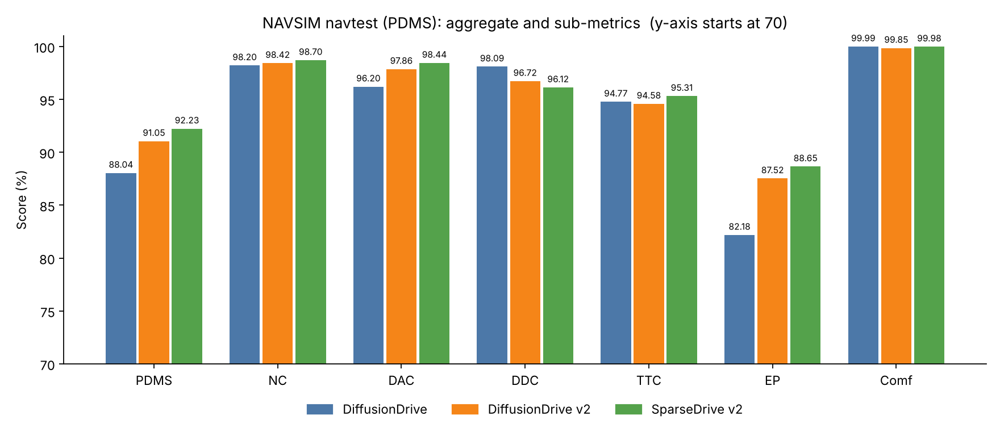
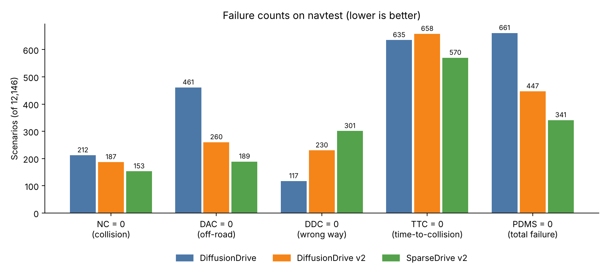
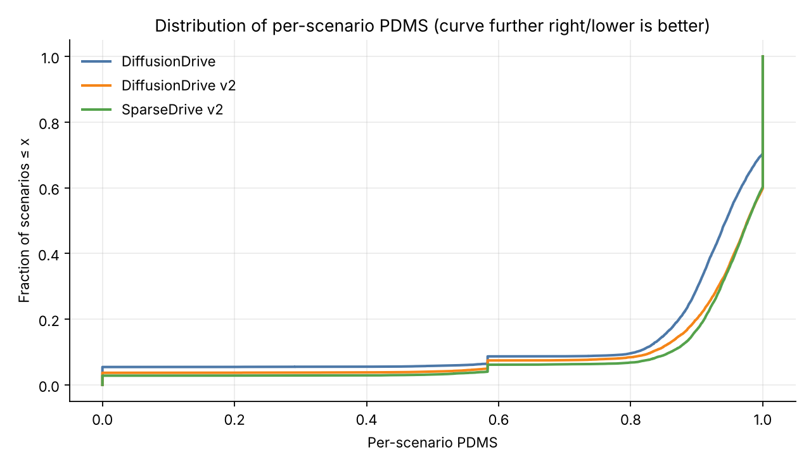

# NAVSIM Planner Comparison

Comparison of **DiffusionDrive**, **DiffusionDrive v2** and **SparseDrive v2** on NAVSIM
(PDMS, navtest): aggregate and sub-metric scores, per-scenario results, and failure analysis.



## Failure analysis





Interactive version: Space `your-username/navsim-planner-comparison` (with a scenario explorer).

## Results (PDMS, %)

| Model | PDMS | NC | DAC | DDC | TTC | EP | Comf | Source |
|---|---|---|---|---|---|---|---|---|
| DiffusionDrive | 88.04 | 98.20 | 96.20 | **98.09** | 94.77 | 82.18 | **99.99** | reproduced |
| DiffusionDrive v2 | 91.05 | 98.42 | 97.86 | 96.72 | 94.58 | 87.52 | 99.85 | reproduced |
| SparseDrive v2 | **92.23** | **98.70** | **98.44** | 96.12 | **95.31** | **88.65** | 99.98 | reproduced |

## Where each model lacks (from these results)
- **DiffusionDrive:** lowest progress (EP 82.18) and the most off-road failures (461 scenarios with DAC = 0).
  Best on wrong-way driving (117 with DDC = 0) and comfort.
- **DiffusionDrive v2:** +3.0 PDMS over v1, from progress (+5.3 EP) and fewer off-road and total failures
  (260 and 447 vs 461 and 661). Wrong-way failures roughly double (230 vs 117) and TTC failures rise slightly (658 vs 635).
- **SparseDrive v2:** best aggregate (92.23 PDMS) and best on collisions, drivable area, TTC and progress,
  with the fewest total failures (341). It has the most wrong-way failures (301 with DDC = 0; DDC 96.12) and the
  lowest DDC of the three.
- **Head-to-head per scenario:** SparseDrive v2 beats DiffusionDrive v2 on 4,096 scenarios and loses on 3,916
  (4,134 ties), so the +1.18 PDMS gap comes from many small differences and not from a few scenarios.

## Files
- `results.csv`: one row per model (aggregates in percent, provenance fields)
- `scenarios.csv`: one row per model × scenario (`token`, NC, DAC, DDC, TTC, EP, Comf, PDMS; fractions in [0, 1])
- `figures/`: static charts, regenerated by `scripts/make_figures.py`
- `scripts/add_model.py`: ingest a NAVSIM per-scenario results file for a new model

## Adding a model (e.g. SparseDrive v2)
```bash
python scripts/add_model.py path/to/results.csv --model "SparseDrive v2" \
    --checkpoint <ckpt> --commit <hash> --seed <n> --backbone <...> --sensors <...>
python scripts/make_figures.py
```
The README table and findings above are edited by hand. `publish.py` refreshes the Space's bundled data.

## Evaluation protocol
- Benchmark: NAVSIM, navtest split (12,146 scenarios), metric PDMS. Per-scenario score =
  NC × DAC × (5·EP + 5·TTC + 2·Comf) / 12; DDC is reported but not part of the PDMS product.
- `TLC`, `LK`, `HC` belong to EPDMS and are empty here.
- Not yet filled in: checkpoints, commits, seeds, backbone, sensors, latency hardware.

## Limitations
- Axes in the sub-metric chart start at 70 to separate the models; the failure chart starts at 0.
- All models should be evaluated with the same protocol; differences in backbone, inputs or training data
  are not controlled here.

## Licensing and citation
Only results and plots are released; NAVSIM, nuPlan and OpenScene data are not redistributed.
Please cite the original papers for each model and NAVSIM.
